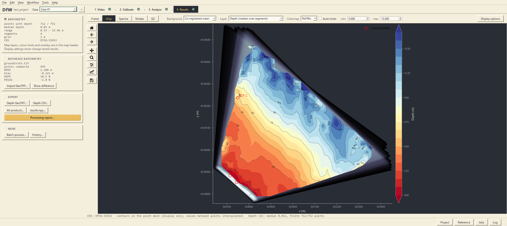

# Depth-from-Wave (DfW) Desktop 1.4.0

Nearshore water depth from UAV video of surface waves: georectification, DMD wave analysis, depth inversion, maps
and quality control. Windows 10/11 x64; runs offline. The desktop source code is not published; the earlier
DfW-algorithm scripts (v1.3) are at [commit de3e617](https://github.com/Bkim-git/DfW-algorithm/tree/de3e617).

## Downloads

The files are on the [v1.4.0 release page](https://github.com/Bkim-git/DfW-algorithm/releases/tag/v1.4.0); their
checksums are in this repository (verify with `certutil -hashfile <file> SHA256`).

| File | Contents | Checksum |
|---|---|---|
| `DfW-Desktop-1.4.0-win64.zip` (217 MB) | Program | [sha256](DfW-Desktop-1.4.0-win64.zip.sha256) |
| `DfW-Tutorial-1.4.0.zip` (1.4 GB) | Example case 1 with a processed tutorial project | [sha256](DfW-Tutorial-1.4.0.zip.sha256) |
| `DfW-Source-1.4.0.zip` (0.1 MB) | Source of the processing code, for reference | [sha256](DfW-Source-1.4.0.zip.sha256) |

## Install

1. Unzip `DfW-Desktop-1.4.0-win64.zip` to a writable local folder outside `Program Files`, preferably one not synced
   by Dropbox or OneDrive (projects hold several GB of intermediate products).
2. Start `DfW.exe`; no installation or Python is required. Windows SmartScreen may warn on the first start because the
   program is not code-signed: "More info" › "Run anyway".
3. F1 opens the user manual; `README.txt` summarises the workflow.

To update, unzip the new version into a new folder, not over the old one; projects open in the new version. `cache\`
holds temporary files and settings and may be emptied while DfW is closed.

## Tutorial

Unzip `DfW-Tutorial-1.4.0.zip` into the program folder (`examples\` next to `DfW.exe`) and open
`examples\example1\Tutorial.dfwproj`. The archive contains the raw 4K UAV video (12.6 min, 2 fps), GCPs, initial
markers, a co-registered video, a basemap, a reference bathymetry and two unprocessed example projects. The tutorial
project adds the manually corrected GCP tracks, the georeferencing and the depth result; Import video and Co-register
rebuild the frames and the co-registered video.

## Source

`DfW-Source-1.4.0.zip` contains the processing functions the program runs (video, rectification, tracking,
georectification, DMD, wavenumber, depth), a README on the processing chain and its differences from DfW-algorithm,
and a runnable example. It is not needed to run the program. MIT licence, Copyright (c) 2026 Byunguk Kim.

## Licences

Third-party notices are in [`LICENSES/`](LICENSES) and in the program folder. Qt and PySide6 are used under the
LGPL-3.0 as separate, replaceable libraries in `lib\`.

## Citation
If you find this tool helpful, please consider citing the following works:
- Kim, B., Park, Y. S., Noh, H., & Baek, S. (2026). Nonlinearity-corrected kinematic depth inversion from UAV imagery in irregular tidal flats: Application to Byeonsan Beach, South Korea. Coastal Engineering, 204, 104904.
- Kim, B., Park, Y. S., Noh, H., & Lee, M. (2025). Improving accuracy of image-based depth inversion with an adaptive window optimization. Coastal Engineering Journal, 67(2), 306-318.
- Kim, B., Noh, H., Park, Y. S., & Lee, M. (2023). Non-spectral linear depth inversion using drone-acquired wave field imagery. Applied Ocean Research, 138, 103625.

## Contact
Feel free to contact me via https://bkim-git.github.io/
